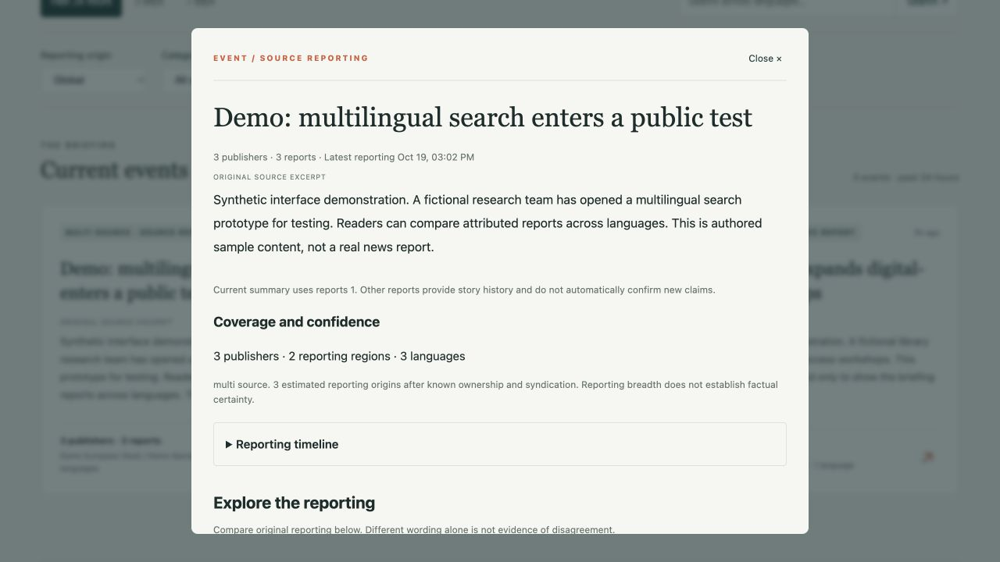
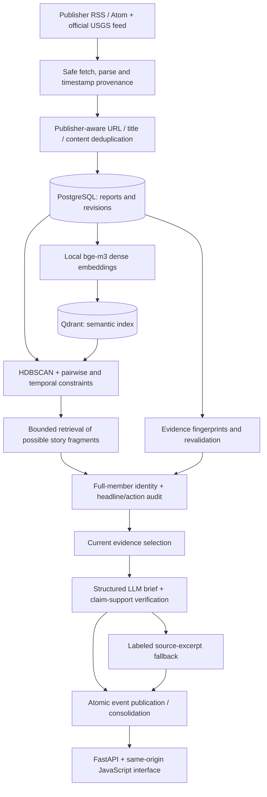

# GIIM — Global Intelligence & Impact Monitor

**Multilingual reporting → coherent stories → attributable evidence.**

GIIM is an applied AI system that organizes news reporting into an event briefing. It combines local multilingual embeddings, density-based clustering, bounded story retrieval and LLM evidence checks so readers can explore what happened, how coverage evolved, and which sources support a summary.

**Status:** locally validated Phase 3 implementation. No public deployment or population-level accuracy claim. Story recall improved in the recorded diagnostics, but contextual over-merging remains an unresolved acceptance issue.

[Architecture](docs/architecture.md) · [Quick start](#quick-start) · [Evaluation](#measured-results) · [Engineering report](PHASE3_EVENT_RECALL_REPORT.md) · [Licensing](docs/licensing.md)

## What it does

- **Event-first briefing:** rolling 24-hour, three-day and seven-day views, source links, language/region coverage and semantic search across languages.
- **Conservative story grouping:** distinguish a bounded incident, its direct developments, and reports that merely share a topic or entity.
- **Attributable AI summaries:** structured output, exact source quotations and claim-support review; fall back to labeled source excerpts when review fails or no LLM key is configured.
- **Evolving stories:** preserve canonical events, source membership and revision history through atomic consolidation. Separate historical reporting from evidence supporting the current summary.
- **Operational safeguards:** publisher-aware deduplication, timestamp provenance, incremental embeddings, vector reconciliation, source failure isolation, advisory locking and authenticated admin routes.

The engineering focus is the recall/precision trade-off in a working retrieval-and-generation pipeline—not simply wrapping a chat API. Evaluation failures, withdrawn summaries and unsuccessful matching trials remain documented.

## Interface

The following images show the actual frontend running locally with **explicitly synthetic, authored demonstration reports in an isolated database**. They illustrate source-excerpt presentation, not real publisher coverage, a production deployment or benchmark outcomes. No publisher article text or private operational data is included in these screenshots.


<details>
<summary>Event detail: source attribution and current supporting evidence</summary>



</details>

## Architecture and data flow



| Component | Role and design choice |
|---|---|
| **bge-m3** | Local 1,024-dimensional multilingual dense vectors through Sentence Transformers. GIIM uses dense embeddings; it does not implement all sparse/multi-vector modes offered by the model. |
| **Qdrant** | Similarity retrieval and a rebuildable semantic index; PostgreSQL remains authoritative. |
| **HDBSCAN** | Initial semantic neighborhoods, constrained by complete-link pair checks and publication-time bounds. Broad retrieval generates candidates, not merge permission. |
| **LLM review** | OpenAI-compatible client, configured for DeepSeek. Full-member identity evidence, a separate headline/action check, then structured generation and claim-support verification. No fine-tuning is claimed. |
| **Continuity** | Direct-update review, stable IDs where justified, transactional consolidation, preserved prior versions and explicit current-support IDs. Material changes invalidate cached decisions on the next selected pipeline pass. |
| **Ranking** | A documented heuristic combining recency, supported impact and reporting breadth. More publishers do not establish truth or neutrality. |

Initial groups are bounded to eight reports / 72 hours. Phase 3 story unions are bounded to 24 reports / seven days, with up to eight reports used for a current brief. The pipeline samples up to 1,500 verified-time reports; consolidation inspects a limited candidate set. These bounds control cost but leave real stories fragmented. Publication time is not assumed to be incident time.

**Stack:** Python 3.11 · FastAPI / Pydantic · SQLAlchemy async / asyncpg · PostgreSQL 16 / Alembic · Qdrant · Sentence Transformers / PyTorch · scikit-learn HDBSCAN · Docker Compose · vanilla JavaScript / CSS · pytest / pytest-asyncio.

## Measured results

Recorded **September 28–29, 2026 UTC**, not continuously updated performance. Phase 3 retained bge-m3 and the initial HDBSCAN thresholds.

| Frozen 90-report diagnostic | Phase 2 | Phase 3 |
|---|---:|---:|
| Correctly grouped positive pairs | 95 | **115** |
| Missed positive pairs | 51 | **31** |
| Scored false merged pairs | 4 | **0** |
| Correctly separated negative pairs | 3,855 | **3,859** |

This net improvement includes **40 recovered pairs and 20 newly separated positives**. It must not be presented as an across-the-board improvement.

The expanded corpus contains **223 real excerpts and 74 explicitly labeled relationships**: 33 agreed positive, 21 topic-only and 20 ambiguous cases. Final review joins **28/33 positives**, separates **21/21 negatives**, and joins **five ambiguous cases**. Labels were proposed by the development agent and checked by a separate blinded model pass—not independent human adjudication. The initially held-out cases informed later iterations, so this is now a diagnostic set, not an untouched benchmark. It is English-skewed and does not measure universal global recall.

A live audit still found broad contextual reporting entering the Madrid/Barcelona continuation. Zero scored false merges therefore does **not** mean zero real errors. A separate dated eight-event discovery reference found six events; that small reference is not a global coverage estimate.

The Phase 3 suite passed **132 tests** in development and a standalone image. A stable measured pipeline pass used **zero new embeddings and zero LLM requests in 10.19 seconds** after caches warmed; new evidence, cache expiry and rule changes legitimately incur work again. These are historical observations, not performance guarantees.

See the [full methodology, failed trials and limitations](PHASE3_EVENT_RECALL_REPORT.md), [public aggregate measurements](evaluation/phase3-summary.json), and [test report](FINAL_TEST_REPORT.md). Original publisher excerpts and raw review outputs are withheld from this public release. The authored synthetic demo does not reproduce those historical measurements; see [data licensing](docs/licensing.md#news-and-evaluation-data).

## Quick start

Requires Docker Engine/Desktop with Compose v2 and Python 3 for generating local configuration. Allow roughly 8 GB RAM for light CPU usage and several GB of disk for the image and model cache; capacity has not been load-tested. Initial dependency/model downloads need internet access. Feed refreshes require network access; AI review additionally needs a privately configured provider key.

From your checkout, create a new `.env` with random credentials. **This command refuses to overwrite an existing `.env`.** It is for a fresh environment; changing a password in `.env` alone does not rotate an already initialized PostgreSQL user's password.

```sh
python3 - <<'PY'
import os
import secrets
from pathlib import Path
text = Path('.env.example').read_text()
text = text.replace('REPLACE_WITH_RANDOM_HEX', secrets.token_hex(24))
text = text.replace('REPLACE_WITH_RANDOM_ADMIN_TOKEN', secrets.token_hex(32))
fd = os.open('.env', os.O_WRONLY | os.O_CREAT | os.O_EXCL, 0o600)
with os.fdopen(fd, 'w') as stream:
    stream.write(text)
print('Created private .env; optional provider key can be configured there.')
PY

docker compose build api
docker compose up -d --wait postgres qdrant
docker compose run --rm --no-deps api alembic upgrade head
docker compose up -d api
```

Open [the application](http://localhost:8000), [API documentation](http://localhost:8000/docs), or [readiness](http://localhost:8000/api/v1/ready). A new database initially has an empty feed. To ingest and process current reporting:

```sh
docker compose exec -T api python -m scripts.pipeline --once
```

This writes to your local application database and fetches configured public feeds. With `DEEPSEEK_API_KEY` blank, generated summaries fall back to source excerpts. Set the key privately in `.env` and recreate the API (`docker compose up -d --force-recreate api`) when you want AI review; provider calls may incur charges. Do not commit `.env`.

The first embedding/search downloads `BAAI/bge-m3` to `.model_cache/`; later runs reuse it. Development service ports bind to loopback and use fixed container names: do not start a second copy with the same names/ports. Never use `docker compose down -v` on data you want to retain.

### Configuration

| Variable | Purpose |
|---|---|
| `DATABASE_URL`, `POSTGRES_*` | Application database and initial PostgreSQL user/database. Keep the URL password consistent with `POSTGRES_PASSWORD`. |
| `TEST_DATABASE_URL` | Separate migrated test database; name must end in `_test`. |
| `QDRANT_URL` | Internal vector service; leave development API key blank only while isolated. |
| `DEEPSEEK_API_KEY`, `LLM_BASE_URL`, `LLM_MODEL` | Optional generation/review provider. The implemented client reads the DeepSeek-named key variable even for a compatible endpoint. |
| `INGESTION_TRIGGER_TOKEN` | Private bearer token for ingestion/admin routes; production requires at least 32 characters. |
| `PIPELINE_MAX_LLM_CALLS` | Per-run review budget, default 20. Budget reservations and actual request counts differ. |
| `EMBEDDING_*` | Model name, cache path and device; Compose defaults to local CPU bge-m3. |
| `APP_ENV`, `CORS_ORIGINS` | Environment validation and optional explicit origins. Same-origin UI needs no CORS override. |

The other provider-key fields are retained compatibility settings, not implemented integrations. `requirements.lock` pins the tested dependency versions; `pyproject.toml` declares direct requirements. The lock is not hash-verified. Docker runs the API as a non-root user with one worker to avoid duplicating the model in memory.

## Tests and evaluation

Create and migrate an **isolated** test database once. These commands use your private configuration without printing its credentials:

```sh
docker compose exec -T postgres sh -c 'createdb -U "$POSTGRES_USER" giim_test'
docker compose exec -T api sh -c 'DATABASE_URL="$TEST_DATABASE_URL" alembic upgrade head'
# No live model/provider/vector integration tests; still requires PostgreSQL.
docker compose exec -T api pytest -q -m 'not integration'
# Full suite: requires model cache/download, Qdrant and a real configured LLM key.
docker compose exec -T api pytest -q
```

If `giim_test` already exists, skip creation; do not drop an existing database. Tests reject a database name without `_test`, use rollback isolation and temporary vector collections. No failing or xfail tests were removed to obtain the historical result.

Public synthetic evaluation is separate from regression tests and does not write to application/vector tables. It uses the same bge-m3 and story-review code, can download the model and can make billable LLM requests. This is an execution demonstration, **not a rerun of the historical Phase 3 benchmark**:

```sh
docker compose cp evaluation/. api:/app/evaluation/
docker compose exec -T api python scripts/evaluate_recall.py \
  --corpus evaluation/synthetic-demo.json --budget 20 --output /tmp/synthetic-recall.json
```

Use a fresh disposable evaluation container: the legacy evaluator reads fixed temporary vector/review cache paths, which must not be shared across unrelated corpora. Do not delete another run's cache. Full historical evaluation requires separately licensed original fixtures that are not distributed here; see [evaluation methodology](docs/evaluation.md).

Release preparation on October 19, 2026 independently passed all **132 tests** (one existing logging warning) against isolated services and a fresh migrated database. The non-integration selection passed **121 tests**, with 11 deselected. The existing model cache was reused; first-time model download was not revalidated.

The sanitized public candidate was separately revalidated: **132 passed**, one existing warning, in 5.76 seconds. Its six-report synthetic demonstration also ran successfully; see [candidate validation](docs/public-release-validation.md).

## Operations and repository map

```sh
# Process stored current evidence, without fetching new reports.
docker compose exec -T api python -m scripts.pipeline --once --no-fetch
# Inspect possible duplicate cards without mutation or LLM calls.
docker compose exec -T api python scripts/consolidate_stories.py
# Audit vector consistency; repairs require an explicit --repair.
docker compose exec -T api python -m scripts.reconcile_vectors
```

Explicit reviewed consolidation uses `--apply --budget N` and the same advisory lock as the pipeline. Legacy mutation scripts remain for historical reproduction; they are gated in development and disabled in production.

| Path | Contents |
|---|---|
| `apps/api/src/` | API, ingestion, embeddings, retrieval, grounding and story services |
| `frontend/` | Same-origin briefing, semantic search and event detail interface |
| `scripts/` | Ingestion/pipeline, consolidation, audits and evaluations |
| `tests/` | Regression, transaction, isolation and integration coverage |
| `alembic/` | Versioned PostgreSQL schema migrations |
| `config/sources.json` | Publisher identity, feed provenance and usage restrictions |
| `evaluation/` | Historical aggregate results and authored synthetic demonstration data |
| `docs/` | Design decisions, operational guides and clearly marked historical notes |

Key APIs: `GET /api/v1/events/today`, `GET /api/v1/events/{id}`, `POST /api/v1/search/events`, `GET /api/v1/coverage`, `GET /api/v1/health`, `GET /api/v1/ready`. Ingestion and detailed operations are protected admin routes. See [deployment and backup/restore instructions](docs/deployment.md) for the existing single-host production configuration; it is not evidence of a public deployment.

## Limitations and next work

- **Story boundaries remain imperfect.** Shared entities, reactions, commentary and multilingual aliases can cause both false merges and false splits. A fresh human-adjudicated continuation benchmark is the next quality gate.
- **Coverage is uneven.** Source availability, partial RSS text, publication timestamps, sampling and candidate limits constrain recall. A multilingual model is not evidence of balanced global reporting.
- **Grounding is a fallible check.** Quotations and model review do not establish truth, neutrality or independence; publisher diversity measures reporting breadth.
- **Revalidation is asynchronous.** Material changes are reviewed on a selected pipeline pass, not immediately at ingestion/read time. Deferred groups retain history while stale AI claims are withdrawn.
- **Costs and scale are bounded, not eliminated.** Cache expiry and new evidence trigger requests. High-traffic operation and sustained scheduler uptime have not been validated.
- **Reproducibility is bounded.** Restricted publisher fixtures and private operational snapshots are withheld; aggregate historical results cannot be independently rerun from the public synthetic examples alone. No project code license has yet been selected.

## License and acknowledgments

**No project code license has been selected.** Public visibility alone is not an open-source license. See [licensing decisions and third-party materials](docs/licensing.md) for MIT/Apache-2.0 implications, bge-m3's upstream license and the separate rights in news content. No license for publisher articles or model weights is granted by this repository.

Built with the open-source components named above. Development included AI-assisted implementation and evaluation; the recorded label review is machine-assisted, not independent human validation. [Security guidance](SECURITY.md) · [Contribution workflow](CONTRIBUTING.md).
