# GIIM Phase 3 architecture

GIIM converts multilingual reporting into evidence-linked event briefs. PostgreSQL is the authoritative store; Qdrant is a rebuildable dense-vector index. The same-origin FastAPI/JavaScript application exposes search, event details, reporting coverage and revision history. This describes the implemented local system, not a public production deployment.

```mermaid
flowchart LR
  A[RSS / Atom and official feeds] --> B[Safe fetch and timestamp provenance]
  B --> C[Publisher-aware deduplication]
  C --> D[(PostgreSQL)]
  D --> E[bge-m3 dense embeddings]
  E --> F[(Qdrant)]
  D --> G[Time-bounded HDBSCAN candidates]
  F --> G
  G --> H[Pair constraints and fragment retrieval]
  H --> I[LLM identity and primary-action review]
  I --> J[Current supporting evidence]
  J --> K[Structured brief and claim verification]
  K --> L[Atomic publication and revisions]
  K --> M[Source-excerpt fallback]
  M --> L
  L --> N[API and event briefing]
```

## Ingestion and identity

`ingestion/safe_http.py`, `rss_fetcher.py` and `source_health.py` bound fetches, preserve conditional-fetch state and isolate source failures. `config/sources.json` records feed and publisher provenance, including usage restrictions. Parsed publication time has a quality label; ingestion time is not substituted as incident time.

`ingestion/deduplicator.py` combines publisher identity, canonical URL, normalized title/content hashes, revisions and stable official identifiers. `title_fuzzy_hash` is a useful candidate signal, not a globally unique event identifier. Distinct official earthquake IDs remain distinct even with similar titles. Non-official recurring headlines can still collide.

## Retrieval and multilingual matching

`embedding/client.py` uses Sentence Transformers with `BAAI/bge-m3`, producing 1,024-dimensional dense vectors. This implementation does not claim the model's sparse or multi-vector modes. Incremental embedding and `services/vector_sync.py` avoid unnecessary recomputation and reconcile PostgreSQL/Qdrant differences.

`services/event_quality.py` constructs initial semantic neighborhoods with HDBSCAN plus pairwise similarity and temporal constraints. Initial groups are bounded to eight reports and 72 hours. This replaces the old ISO-week-only clustering behavior; time is still a heuristic rather than proof of shared incident identity.

`story_matching.py` retrieves possible fragments. `story_review.py` reviews full-member identity and separately checks the primary action. Shared actors, locations or topics do not grant merge permission. Phase 3 unions are bounded to 24 reports/seven days, and the pipeline selects up to 1,500 verified-time reports. Recall remains limited by these budgets and candidate gates.

## Grounding and continuity

`event_preparation.py`, `story_brief.py` and `claim_verification.py` select up to eight current evidence reports, request structured output with exact source quotations, and separately assess claim support. Failure or absent provider credentials leads to labeled source-excerpt presentation. Exact quotations and model agreement do not establish factual truth.

`story_consolidation.py`, `story_state.py`, `event_history.py` and `event_update.py` preserve canonical identity, membership and revisions transactionally. Historical members are distinct from the reports supporting current claims. Evidence fingerprints and rule versions invalidate cached decisions. Revalidation occurs on a selected pipeline pass; it is not synchronous with every read or ingestion.

## Serving and operations

FastAPI serves the frontend and endpoints for event feeds, semantic event search, details, coverage, health and readiness. Administrative routes require a token. Production configuration provides single-host Compose/Caddy deployment, private storage services, a non-root API and one worker to avoid duplicating the model. These are deployment provisions, not uptime or scale results.

The pipeline uses PostgreSQL advisory locking and preserves the last successful state on failures. Tests use a separate `_test` database and rollback isolation. The former asyncpg event-loop issue is covered by the revised fixtures; no xfail deletion is needed for the current passing suite.

## Measured trade-offs

Phase 3 improved the dated 90-report positive-pair result from 95 to 115, while losing 20 previously joined positives and recovering 40. Contextual over-merging persists outside the scored negative cases. Labels were machine-assisted, the former holdout informed tuning, and the corpus is English-skewed. See [evaluation](evaluation.md) and the [Phase 3 report](../PHASE3_EVENT_RECALL_REPORT.md).

Next quality work should use fresh human-adjudicated direct-update versus contextual-reporting cases before relaxing candidate gates. bge-m3, storage architecture and existing safeguards are retained.
