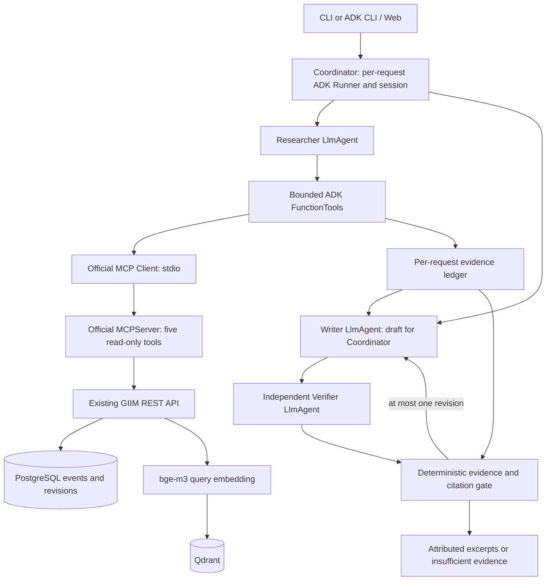

# GIIM MCP and Google ADK analyst

Task 2 adds independently installed, read-only components to the Phase 3 backend. It preserves bge-m3, Qdrant, clustering, event continuity, ingestion, the existing LLM publication client and the frontend. The default demonstration uses authored synthetic reports and a scripted ADK model; it makes no hosted model requests.

The implementation and local validation report is [here](reports/mcp-agent-report.md). Live Gemini quality, deployment and human evaluation remain unverified. This is a conservative **extractive analyst**: final factual output consists of attributed, policy-limited current-source excerpts. It does not accept arbitrary generated factual prose.

## Architecture and actual execution



There are three user-facing roles and four ADK nodes: a custom root `Coordinator`, `Researcher`, an internal `Writer` for the Coordinator's draft, and `Verifier`. The Researcher uses typed ADK `FunctionTool` wrappers around an official MCP client. This is real protocol communication, not direct calls to the adapter and not a claim of using ADK's `McpToolset` abstraction.

Research runs first. Only tool-returned event IDs may be used to fetch details. The gateway records validated detail responses in a fresh ledger and the Coordinator copies that evidence into session state. Writer and Verifier have independent static instructions and structured schemas; neither has tools. Retrieved data is supplied separately from system instructions. The Verifier's approval is advisory. A Python gate checks the draft before the CLI or ADK entry returns anything. Internal draft events are consumed inside the workflow; the ADK Web wrapper emits only the final response.

The gate requires exact event UUID, positive integer article ID, publisher and source URL associations from this request. A quote must exactly equal the complete permitted excerpt. All retrieved current support must be represented; omitted disagreements, unknown references, duplicate citations, unavailable evidence, stale/inactive events and missing uncertainty cause refusal. Historical revision sources cannot ground a current answer. An unresolved draft gets one revision, then an explicit insufficient-evidence response with no factual claims or citations.

## Tested SDKs and isolation

Python 3.11 was tested. Direct pins: MCP **2.3.0**, Google ADK **2.14.0**, Google GenAI **2.34.0**, Pydantic **2.14.3**, httpx **0.28.1**. MCP v2 also uses separately pinned httpx2. See `apps/agent/requirements.lock` for the complete tested environment; it includes local testing tools and is not hash-verified. Do not install it into the existing API environment.

Official documentation and installed signatures/source were inspected before integration:

- [MCP Python SDK v2.3.0](https://github.com/modelcontextprotocol/python-sdk/tree/v2.3.0): `MCPServer` is the v2 name replacing `FastMCP`; `Client`, typed responses, lifespan and transports are exercised in tests.
- [ADK Python v2.14.0](https://github.com/google/adk-python/tree/v2.14.0): `Runner`, `BaseAgent`, `LlmAgent`, `FunctionTool`, `BaseLlm`, callbacks and session events.
- [ADK Gemini configuration](https://adk.dev/agents/models/google-gemini/) and [Google's model catalog](https://aistudio.google.com/docs/models), checked November 10, 2026. The configurable default is `gemini-3.5-flash-lite`. Recheck availability and terms before a future live run.

## Install and run without credentials

From the repository root, with Python 3.11 installed:

```sh
python3.11 -m venv .agent-venv
. .agent-venv/bin/activate
python -m pip install -r apps/agent/requirements.lock
python -m pip install --no-build-isolation --no-deps -e apps/mcp_server -e apps/agent
python -m pip check
python -m giim_agent ask "What happened at the AI laboratory?" --demo --trace
python -m giim_agent ask "What is the unicorn stock price?" --demo --json
```

The first answer contains three synthetic EN/ZH/ES excerpts with citations, `mode=fake`, `verified=true`, two tool calls and five model calls. The second returns `insufficient_evidence` and exit code **2** intentionally. Verified answers exit 0; invalid CLI configuration exits 1 or argparse's usage code. Fake models never contact Gemini. Without `--demo`, fake models use the configured real GIIM API; they remain scripted and are not a general reasoning system.

An independently built Docker image also supports non-editable installed packages:

```sh
docker build -f apps/agent/Dockerfile -t giim-agent-task2:local .
docker run --rm giim-agent-task2:local ask "AI laboratory" --demo --json
mkdir -p .runs/docker
docker run --rm -v "$PWD/.runs/docker:/app/.runs" giim-agent-task2:local \
  ask "AI laboratory" --demo --trace
```

The image runs as UID 10001. On Linux, arrange ownership of the bind-mounted trace directory for that UID. The Docker demo needs neither a database nor model weights. Initial image/dependency downloads require internet access.

## Connect to existing GIIM

Use the existing [GIIM quick start](../README.md#quick-start) for a fresh backend, or connect to an already running instance. Do not recreate or seed an existing database for this demo. No ingestion is required for read-only access. These components do not automatically load `.env`; export settings in the invoking process or configure a private client environment. Example files contain placeholders only.

```sh
export GIIM_API_URL=http://127.0.0.1:8000
python -m giim_agent ask "Which AI events have supporting reports?" --json
```

Remote API origins require HTTPS; URL credentials, paths, query strings and fragments are rejected. For container-local testing, the analyst can share the API container's network namespace and use loopback. The MCP subprocess receives only required API configuration and a minimal process environment, never Gemini, database or admin credentials.

`GIIM_MCP_PUBLISHER_CAPS` maps exact publisher names to authorized excerpt lengths from 0–500. It defaults to `{}`, which withholds **every publisher excerpt**. Configure only after reviewing the source's terms and permitted use; a character limit does not establish a legal entitlement. The demo supplies caps only for its authored fixtures. Real-data answers will often refuse until this policy is configured. Source URLs are never fetched by the agent.

## MCP tool contracts

Every tool returns structured `Envelope {ok, data, error, truncated}`. `data.kind` is `listing`, `detail`, `coverage` or `readiness`; error codes are stable and omit raw upstream responses. SDK validation errors use MCP `isError`. Extra arguments, invalid UUIDs and out-of-range limits are rejected. Complete JSON schemas are available through `tools/list` and in `giim_mcp.models`/`inputs`.

| Tool | Input | Actual data / REST route |
|---|---|---|
| `giim_get_today_events` | `window="24h"`: 24h/3d/7d; `limit=10`: 1–25; optional `language` of 2–20 characters | `Listing.events`: UUID, title, summary, `first_seen_at`, `last_updated_at`, source count, languages, evidence status. GET `/api/v1/events/today`. Optional language filter examines at most 50 API events and is explicitly non-exhaustive. |
| `giim_search_events` | nonblank `query`: 1–300 characters; optional window; `limit=10`: 1–20 | Ranked event cards and associated source metadata. POST `/api/v1/search/events`, a read-only search. Null window maps to seven days. Existing rank order retained; API does not return similarity scores, so `relevance_score=null`. |
| `giim_get_event` | `event_id`: UUID | `Detail`: event, status, articles, current integer evidence IDs, review status and up to 20 compact revisions. GET `/api/v1/events/{id}` with limit 100. Aliases must be requested by canonical ID; identity mismatch is rejected. |
| `giim_get_coverage` | no arguments | Observed 24-hour coverage and available regional counts via GET `/api/v1/coverage`. Unsupported global supported-language/indexed-article/tracked-event totals are null and named in `unsupported`. |
| `giim_check_ready` | no arguments | API/storage flags via GET `/api/v1/ready`. Model loading is absent in this Phase 3 API, so `search_ready` remains null even if storage is healthy. |

Sources contain `article_id`, `event_id`, publisher, URL, publication time, language, title, permitted excerpt, current-support membership, time quality and excerpt policy. Unknown fields remain null rather than being inferred. Current-support IDs come from `current_support_ids`; revision evidence IDs come from `reporting[].news_id`. Event IDs are UUIDs; article IDs are **integers**.

Event-card `summary` is deliberately null with `summary_policy=withheld_without_source_permissions`: the upstream summary can be a raw publisher-text fallback, and card responses do not establish per-source redistribution permission. This rule applies to recent-event, search and detail cards. The original GIIM UI/API is unchanged; the MCP detail's separately authorized source excerpts remain available. A summary field must not bypass publisher excerpt limits.

Responses cap structured JSON at 20,000 bytes, plus small protocol overhead. Whole list elements may be removed with `truncated=true`; the analyst refuses incomplete detail evidence. Excerpts default to a maximum of 500 characters, further constrained by publisher policy. Query-bearing, fragment-bearing or credential-bearing source URLs are withheld. No full publisher articles or arbitrary provenance blobs are returned.

The HTTP adapter permits only the five fixed route patterns above. Timeout defaults to 10 seconds; one jittered retry is allowed for transient network errors and HTTP 429/502/503/504. HTTP 404/422, oversized upstream bodies and malformed data have explicit errors. No redirect following or ambient proxy configuration is enabled.

## MCP transports and inspection

stdio is the default. An MCP client launches the process; running it alone waits for protocol input:

```sh
python -m giim_mcp
python -m giim_mcp --transport streamable-http --host 127.0.0.1 --port 8001
```

The HTTP endpoint is `/mcp`. Non-loopback binding requires a privately generated bearer token of at least 32 characters in `GIIM_MCP_TOKEN`, an explicit `GIIM_MCP_PUBLIC_HOST`, and a separately secured TLS proxy. Host validation includes the configured port; configure the proxy's forwarded Host accordingly. Use exact comma-separated `GIIM_MCP_ORIGINS` if browser-origin access is needed; wildcard origins are forbidden. Requests without Origin are accepted for native clients. Set a token even on loopback when local access must be restricted. This is single-token transport protection, not multi-tenant OAuth or production identity management.

[MCP Inspector](https://modelcontextprotocol.io/docs/tools/inspector) documents Node 22.19+ and the following client invocation style. Inspector itself was not installed or visually tested in this task; official Python client discovery and calls were tested over both transports.

```sh
npx @modelcontextprotocol/inspector .agent-venv/bin/python -m giim_mcp
npx @modelcontextprotocol/inspector --cli .agent-venv/bin/python -m giim_mcp --method tools/list
```

For another MCP client, configure its stdio command as the absolute `.agent-venv/bin/python` path, arguments `[-m, giim_mcp]`, and only the GIIM settings it needs. Do not include model/admin keys. Inspector downloads are optional and its authentication-bearing launch URL must remain private.

## ADK CLI and Web

The official installed commands were exercised automatically, including the local web session API. The outer entry returns only final gated output. Use in-memory services to avoid creating persistent ADK sessions:

```sh
export GIIM_ADK_DEMO=1 GIIM_ADK_LIVE=0
adk run --session_service_uri memory:// --artifact_service_uri memory:// \
  --memory_service_uri memory:// --log_level error \
  apps/agent/adk_app/giim_analyst "AI laboratory"
adk web --host 127.0.0.1 --port 8002 --session_service_uri memory:// \
  --artifact_service_uri memory:// --memory_service_uri memory:// \
  apps/agent/adk_app
```

Open `http://127.0.0.1:8002` and select `giim_analyst`. Keep this development UI on loopback; it is not a production authenticated service. Visual browser review remains manual. Each question creates a fresh internal evidence session; cross-turn conversational memory is intentionally not used as evidence.

## Optional live Gemini — manual approval required

**BLOCKED — MANUAL VERIFICATION REQUIRED.** No live calls were made. The Gemini adapter, configuration and retry options were tested with mocked constructors, not a provider response. After explicit authorization for paid calls, provision `GOOGLE_API_KEY` privately, set `GIIM_ENABLE_LIVE_GEMINI=1`, and choose a currently available model using `GIIM_AGENT_MODEL`. Optional `GIIM_RESEARCHER_MODEL`/`GIIM_VERIFIER_MODEL` override their roles; CLI `--model` overrides the general model. Authentication uses the Gemini API, explicitly not Vertex AI.

```sh
# Only after approval, with private key and licensed evidence already configured:
export GIIM_ENABLE_LIVE_GEMINI=1
python -m giim_agent ask "Which AI events have supporting evidence?" --live --trace --json
```

For ADK CLI/Web, also set `GIIM_ADK_DEMO=0 GIIM_ADK_LIVE=1`. Demo and live modes are mutually exclusive. Provider timeout is 20 seconds with two total attempts. Check provider errors, schema support, tool selection, relevance, refusals, latency and measured usage on approved data before any production claim. Successful citation checks do not establish a source's truth or an answer's relevance.

## Execution and privacy boundaries

| Bound | Default / hard maximum |
|---|---|
| Tool rounds / full details / total calls | 3 / 5 / 9 |
| Model calls / draft iterations | 10 / 2 (one revision) |
| Output tokens per call | 2,048 |
| Serialized model context | 65,000 bytes per call |
| Conservative request token reservation | 120,000 (UTF-8 input bytes plus reserved output tokens) |
| Request deadline | 60 seconds by default; programmatic `Limits(timeout=...)` permits at most 180 |

Limits can be lowered through the Python API; a model cannot increase them. The reservation is a conservative local guard, not provider tokenization or a billing estimate. There are no filesystem, shell, general browser, write/admin or external search tools. Prompt-injection pattern checks are deliberately conservative and incomplete; the additional capability allowlist, independent ledger and exact citation/quote gate enforce the core boundaries even when the fake verifier approves malicious drafts.

`.runs/`, `.adk/`, local environments, `.env` and model/data caches are ignored. JSONL trace files are created with mode 0600 under a private directory and do not log source excerpts. They do contain questions and tool arguments after secret redaction: keep them private, apply retention policy, and do not assume redaction detects arbitrary personal information. The application runs with normal process privileges; absence of model filesystem tools is not an operating-system sandbox.

## Tracing and estimated cost

```sh
python scripts/summarize_runs.py .runs
python scripts/summarize_runs.py .runs/eval
```

Traces record request IDs, timestamps, question, roles, bounded tool arguments and durations, model calls/latency, reported tokens, verification failures, revisions and final status. Exceptions are classified without logging raw response bodies or stack details. Unknown usage remains null, including fake-model tokens and costs. `GIIM_MODEL_PRICES` accepts JSON keyed by exact model ID with nonnegative `input_per_million` and `output_per_million` USD rates, supplied after reviewing current provider pricing. No rate is invented or fetched automatically.

Estimated cost is `(input_tokens × input_rate + (output_tokens + thinking_tokens) × output_rate) / 1,000,000`; it does not account for every possible provider discount, cache policy or pricing tier. Missing usage or any unpriced call makes request cost null. Actual billed charges are not collected. The summary distinguishes verified answers, insufficient-evidence outcomes, execution errors, incomplete traces and missing usage. p50/p95 use nearest rank across completed requests; tokens/second uses only measured requests.

## Tests, evaluation and human review

```sh
python -m pytest -q -c apps/agent/pyproject.toml apps/agent/tests apps/mcp_server/tests
ruff check apps/agent apps/mcp_server scripts/summarize_runs.py scripts/sample_agent_evals.py
ruff format --check apps/agent apps/mcp_server scripts/summarize_runs.py scripts/sample_agent_evals.py
python -m giim_agent.eval --output .runs/evaluation.json --trace-dir .runs/eval
python scripts/sample_agent_evals.py .runs/evaluation.json --output .runs/human-review.json
python scripts/summarize_runs.py .runs/eval
```

The evaluation has 24 authored cases, three in each of eight categories: basic retrieval, multilingual queries, evolving events, insufficient evidence, conflicting reporting, injection, citations and budgets. Every case traverses real ADK and subprocess MCP. Fake models and keyword-routed fixture search are explicit; faults deliberately exercise corrupted references, bad arguments, unauthorized tools and loops. Checks validate status, evidence associations, exact quotes, expected events, refusal behavior, budgets and output schema. This measures software behavior, **not Gemini accuracy, bge-m3 recall or general injection immunity**. Human sampling is deterministic (seed 42) and leaves all ten ratings empty.

The runner saves date, dataset version, model and Git state. In an image without Git, provide the actual build checkout's `GIIM_EVAL_COMMIT` and `GIIM_EVAL_DIRTY` or accept unknown metadata. These are provenance supplied by the caller, not a cryptographic attestation. Existing backend regressions require their own isolated PostgreSQL/Qdrant environment; Task 2's two original live-provider tests were explicitly not run to respect the no-billing restriction.

### Optional actual-backend smoke on a fresh isolated stack

The committed harness has no fixed container names, host database ports, existing data mounts, ingestion scheduler or provider credentials. It requires an existing bge-m3 cache, mounted read-only; offline flags prevent implicit downloads. Set `GIIM_FIXTURE_MODEL_CACHE` to its absolute path. Generate a private hex `GIIM_FIXTURE_PASSWORD`; never print or commit it.

```sh
export GIIM_FIXTURE_PASSWORD="$(python3 -c 'import secrets; print(secrets.token_hex(24))')"
export GIIM_FIXTURE_MODEL_CACHE=/absolute/path/to/existing/model-cache
docker compose -f apps/mcp_server/tests/support/compose.yml config --quiet
docker compose -f apps/mcp_server/tests/support/compose.yml build
docker compose -f apps/mcp_server/tests/support/compose.yml up -d --wait postgres qdrant
docker compose -f apps/mcp_server/tests/support/compose.yml run --rm api alembic upgrade head
docker compose -f apps/mcp_server/tests/support/compose.yml run --rm \
  -e GIIM_TASK2_FIXTURE_ALLOW=isolated-empty-test-stack api python /support/seed_api.py
docker compose -f apps/mcp_server/tests/support/compose.yml up -d --wait api
docker compose -f apps/mcp_server/tests/support/compose.yml run --rm analyst
```

Seeding is a test-only write, outside the MCP packages' runtime path. It refuses nonempty article/event/vector stores. Run once on a fresh isolated test stack; do not remove data to make it run again. It inserts one authored event and three reports/vectors. The smoke invokes all five tools against real FastAPI, PostgreSQL, Qdrant and cached CPU bge-m3, then verifies an ADK answer using fake models. The same seed/smoke scripts were exercised against the isolated Task 2 validation stack; this portable Compose file was configuration-validated, not independently rebuilt as a second full backend stack. Cross-store fixture seeding is not transactional across PostgreSQL and Qdrant; interruption can require a separately named fresh test stack, never destructive cleanup of existing data.

## Two-to-three-minute interview demonstration

After installation, run these locally; no key is necessary:

```sh
python -m giim_agent ask "What happened at the AI laboratory?" --demo --trace --json
python -m giim_agent ask "Compare the storm briefing reports." --demo --trace
python -m giim_agent ask "Inspect the adversarial article." --demo --trace
python -m giim_agent ask "What is the unicorn stock price?" --demo --trace
python scripts/summarize_runs.py .runs
```

Show the first answer's source UUID/integer IDs, then open the printed private trace path: Researcher calls search/detail, Writer drafts, Verifier reviews, and the deterministic gate passes. The storm answer preserves both 12-person and 18-person reports with attribution and uncertainty. Adversarial and unknown queries refuse with exit 2 and no claims. Explain that `.runs` contains timings but token/cost fields are null for the fake model. The full 24-case runner is an optional follow-up, not evidence of real-model performance.

## Limits and extension points

No free-form factual synthesis, source translation, follow-up evidence memory, live Gemini evaluation, human ratings, production deployment, load testing or broad retrieval benchmark is claimed. A five-detail/three-round budget and conservative policy checks can reject useful answers; long sources may be cut at the permitted character boundary. Exact quoting prevents unsupported text changes but cannot establish source truth, freshness outside the API's scope, or completeness of retrieval. Source metadata and upstream event assignments remain trust boundaries. Expand these capabilities only with a separately reviewed design and fresh evidence-based tests.
